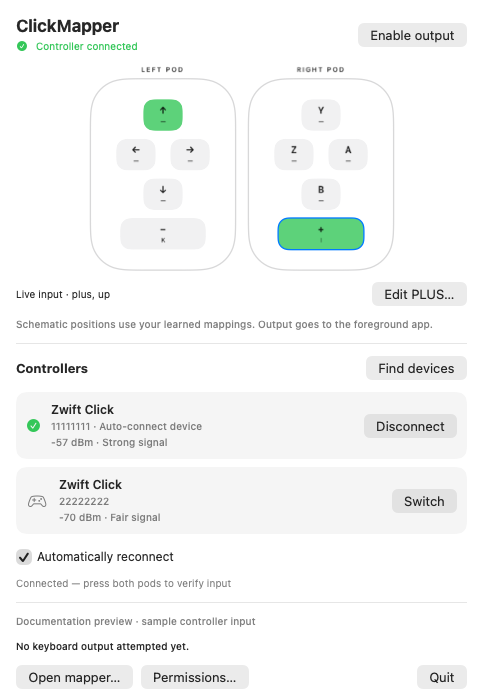
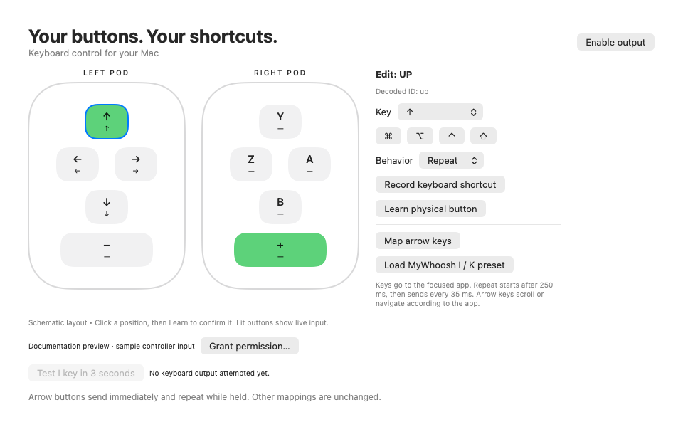

# ClickMapper

Turn Zwift Click V2 controllers into a customizable keyboard remote for macOS. Map buttons to keys and shortcuts for document navigation, presentations, media applications, games, or other keyboard-driven workflows.

ClickMapper runs in the menu bar, shows live controller input, and sends mapped keys to the focused application.

## Features

- Configurable keys and Command, Option, Control, and Shift modifiers for ten controller inputs.
- Tap, hold, and fast repeat behavior.
- Interactive pod diagrams with live button highlights and physical-button learning.
- Zwift Click discovery with stable device rows and automatic reconnection.
- Locally saved mappings and a menu bar panel that works without an open main window.
- Arrow-key navigation and an optional MyWhoosh shifting preset.

## Screenshots

The following previews use sample button input and fictitious device identifiers.

### Menu bar panel



### Mapping editor



## Requirements

- macOS 14 or later.
- Swift 6 toolchain to build from source.
- Zwift Click V2 controllers and Bluetooth access.
- Accessibility permission to send keyboard input.

## Build and launch

### Install from a disk image

Open `ClickMapper-0.1.0-arm64.dmg`, quit any running ClickMapper instance, and drag **ClickMapper.app** to **Applications**. Eject the disk image and launch `/Applications/ClickMapper.app`. Grant Bluetooth and Accessibility access if prompted, then fully quit and reopen the installed app if keyboard posting still shows denied.

This package targets Apple silicon Macs running macOS 14 or later. To start at login, add the installed app under **System Settings → General → Login Items & Extensions → Open at Login**. Remove any old login item pointing to the development build. Saved mappings are shared with the development build; run only one copy at a time.

The locally built installer is ad-hoc signed and not notarized. Distribution to other users with standard Gatekeeper acceptance requires [Developer ID signing and Apple notarization](https://developer.apple.com/macos/distribution/).

### Build from source

```sh
./scripts/build-app.sh
open 'build/ClickMapper Diagnostic.app'
```

The bundle retains its original `ClickMapper Diagnostic.app` name and `local.clickmapper.diagnostic` identifier. Click the keyboard icon in the menu bar to open the control panel.

**Building resets ClickMapper's Accessibility approval.** The build script quits the running app, packages and signs the new build, then resets permission for this app only. Grant access again after rebuilding, fully quit ClickMapper, and reopen it before enabling output. The script reports an error if the reset cannot run in the current environment.

## Getting started

1. Wake both pods and close other applications connected to them.
2. Choose **Find devices** in the menu bar panel, then **Connect** beside a Zwift Click device. Short IDs distinguish devices with the same name.
3. Press buttons on both pods and check the live diagrams. If only one responds, use **Switch** to try the other device.
4. Open the mapper and configure the buttons. Use **Learn physical button** if a diagram position does not match the physical input.
5. Choose **Permissions…** or **Grant permission…**, then allow ClickMapper in **System Settings → Privacy & Security → Accessibility**. Fully quit and reopen the app after granting access.
6. Enable output and focus the application you want to control.

Output starts disabled and is disabled after a disconnect. Closing the mapper window keeps the menu bar app running; **Quit** in the panel stops it completely.

## Button mappings

Select a button in the diagram, choose a key, and add modifiers as needed. **Record keyboard shortcut** captures a shortcut from your keyboard. Escape cancels recording; choose Escape from the key menu to assign it.

| Behavior | Result |
| --- | --- |
| Tap | Sends one key press immediately for each controller press. |
| Hold | Keeps the key down until the controller button is released. |
| Repeat | Sends key-down immediately, waits 250 ms, then sends keyboard autorepeat events every 35 ms. Sends key-up on release. |

Each distinct controller press is processed immediately, without a debounce delay. Repeat timers stop on release, disconnect, output disable, mapping changes, or a foreground-app change. Sleep disables output.

Mappings use macOS physical key codes, so character output follows the active keyboard layout. Output is available across foreground applications; ClickMapper itself is excluded.

### Arrow keys and scrolling

Choose **Map arrow keys** to map the four directional buttons to repeating arrow keys. Other button mappings are preserved. Fresh installations start with these four mappings; selecting an arrow key in the editor also selects Repeat behavior.

A quick press sends one arrow key immediately. Holding the button repeats it, like keyboard navigation. The focused application determines the result: a webpage may scroll, an editor may move the caret, and a list may move its selection. Focus the appropriate document or pane first. If physical arrow keys do not scroll that view, mapped arrow keys will behave the same way.

There is no separate mouse-wheel scrolling action. Previously saved long-press scrolling mappings migrate to the corresponding repeating arrow keys. Other saved mappings remain unchanged.

### MyWhoosh preset

**Load MyWhoosh I / K preset** replaces the keyboard mappings with **plus → I** and **minus → K**, leaving the other buttons unassigned and retaining learned physical positions. MyWhoosh documents these keys for [MyShift virtual shifting](https://mywhoosh.com/myshift-mywhooshs-virtual-shifting-explained/). Enable MyShift in the game and verify the gear direction in your installed version.

## Connection behavior

Discovery lists only advertisements named Zwift Click and keeps rows in discovery order while signal strength updates. The last device to produce recognized input is remembered for automatic reconnection. Only that device is retried, avoiding arbitrary selection between identically named pods.

Automatic reconnection is enabled by default and can be disabled in the panel. Manual **Disconnect** or **Cancel** pauses it until you choose **Resume**, connect manually, or relaunch. The app supports one Bluetooth peripheral connection at a time; both physical pods have produced input through a single connection during testing.

## Troubleshooting

**Accessibility granted, keyboard posting denied:** fully quit using **Quit** in the menu bar panel, then reopen the unchanged app. Closing the mapper window is not sufficient. This restart resolved the permission mismatch observed during development.

**Permission remains denied:** check that the app in Accessibility settings is the current build. To reset only ClickMapper's approval, run:

```sh
sh scripts/reset-permission.sh
```

Reopen the app, grant access, then fully quit and reopen once more. The reset script does not grant permission automatically.

**No keyboard output:** enable output, focus another application, and check the selected button's mapping. Use **Test I key in 3 seconds**, then focus a blank TextEdit document to test output independently of Bluetooth. The output status and diagnostic log report blocked input and attempted key delivery.

**Arrow scrolling moves only once or feels slow:** check that the mapped arrow button uses **Repeat**, not **Tap**. Saved Tap mappings remain Tap across upgrades. Choose **Map arrow keys** to configure all four directions for held-key repeat without changing other buttons.

## Development

Create an installer with:

```sh
./scripts/package-app.sh
```

The installer is written to `dist/`. Packaging creates a separate `build/package/ClickMapper.app`; it does not quit the running app, reset permissions, or replace an installed copy. The development command `./scripts/build-app.sh` retains its permission-reset behavior. `CLICKMAPPER_SIGN_IDENTITY` can select a signing identity; packaging defaults to ad-hoc signing and does not perform notarization.

Run the mapping checks with:

```sh
./scripts/test.sh
```

Tests use a fake keyboard event sink and do not inject keys. Native arrow-event checks also inspect character codes, navigation flags, and autorepeat metadata; these checks need access to the macOS graphical session. They cover rapid presses, repeat timing and cancellation, held keys, saved mappings, and migration from the retired scroll configuration. Real application behavior and Bluetooth reconnection require hardware testing.

### Version control

Commit source, tests, scripts, documentation, and documentation screenshots:

```sh
# Run git init first if this directory is not yet a Git repository.
git add .gitignore Package.swift README.md Sources/ Tests/ scripts/ docs/
git diff --cached --stat
git diff --cached
git commit -m "Add configurable macOS controller mapping and menu bar controls"
```

`.gitignore` excludes `.build/`, `build/`, `dist/`, and `.DS_Store`. Keep generated app bundles, build caches, and unsanitized diagnostic logs or personal screenshots out of Git. The images in `docs/screenshots/` are intended to be committed.

## Compatibility and protocol

Firmware 1.0.1 has produced all ten decoded inputs beyond ten minutes, resumed after idle, and registered simultaneous holds. Keyboard output has been confirmed on the development Mac. Other firmware, sleep/wake recovery, automatic reconnection, and application-specific behavior require further verification. See [protocol observations](docs/protocol-observations.md).

Protocol constants and candidate button positions derive from the MIT-licensed [community mapper](https://github.com/nrbz467bct-dot/zwift-click-keyboard-mapper/blob/main/zwift_click_mapper.py). ClickMapper recognizes its seven-byte `23 08` state format and uses its handshake and keepalive. Pod diagrams are schematic; physical positions can be learned locally.

ClickMapper does not update firmware, connect to a trainer, or decode other packet formats. Mouse actions, text macros, and multiple mapping profiles are not implemented. Diagnostic logs are bounded and kept in memory; unknown payloads are omitted. Remove device identifiers before sharing logs.
